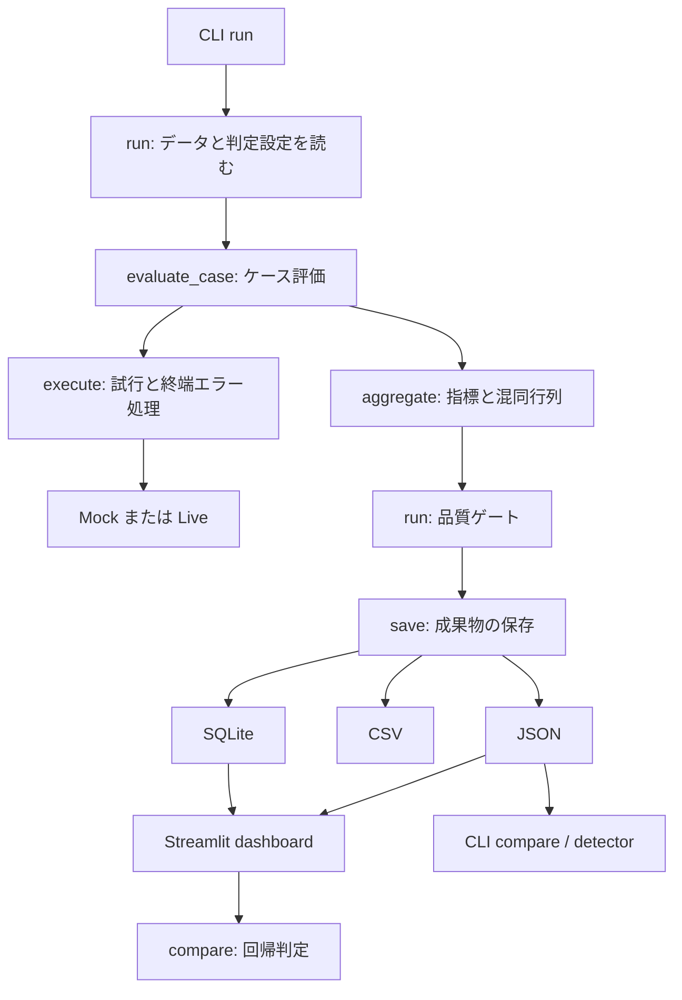

# LLM Evaluation Platform 学習用技術解説書

## 構成と実行の流れ

評価器は CLI から起動する Python プログラムです。モデルとの通信はアダプターに閉じ込め、Streamlit は実行済みの成果物を読み取ります。

| ファイル | 役割 |
|---|---|
| `llm_eval/__main__.py` | `run`、`compare`、`detector` の CLI と終了コード |
| `llm_eval/adapters.py` | `Adapter` 契約、`Reply`、模擬応答と実接続の実装 |
| `llm_eval/core.py` | ケース判定、集計、品質ゲート、回帰比較、保存 |
| `quality.json` | 再試行設定、品質ゲート、回帰と検出器の閾値 |
| `data/dev.json` / `data/holdout.json` | 開発・最終確認に使う合成ケースと期待値 |
| `dashboard.py` | 成果物の読み取り、比較、可視化とダウンロード |
| `tests/test_platform.py` / `tests/test_dashboard.py` | 評価器の契約、AppTest、出力間の整合性 |
| `pyproject.toml` / `uv.lock` / `.github/workflows/evaluation.yml` | 標準依存の宣言とロック、CI の実行手順 |
| `requirements-dashboard.in` / `requirements-dashboard.txt` | 画面の直接依存と Linux x86_64・Python 3.14 向けハッシュ付きロック |

## 主要機能の 5W1H

| What | Why | Who | When | Where | How |
|---|---|---|---|---|---|
| ケースの実行と採点 | 再現可能な応答チェックと障害分類のため | AI QA、SDET | モデル・プロンプトの変更時 | `core.execute`、`evaluate_case`、`check`、`adapters.Mock` / `Live` | 応答形式を確認し、再試行対象を限定する。完全一致、根拠行、JSON 型と値域、禁止文字列で判定する |
| 回答品質・障害の集計 | 取得できた回答の品質と実行経路の信頼性を把握するため | Evaluation Engineer | 実行後の集計時 | `core.aggregate`、`outcome_metrics` | 通常と障害注入に分け、ケースの合否と終端エラーを数える |
| 評価器の測定 | 未支持回答を見落とす頻度を把握するため | AI QA | 判定ルールのレビュー時 | `core.aggregate`、`__main__.main` の `detector` 分岐 | 人手ラベルと予測を照合し、正常・劣化モックを合わせて検出器の閾値を確認する |
| 品質ゲートと回帰 | リリース判断を同条件で再現するため | SDET、レビュー担当 | CI や候補モデルのレビュー時 | `core.run`、`compare` | 閾値・安全性・障害処理からゲートを判定し、比較条件の一致を確認して許容差を照合する |
| 成果物の保存と可視化 | QA が同じ実行結果を調査・共有するため | AI QA、レビュー担当 | 実行後や不合格の調査時 | `core.save`、`read_runs`、`csv_payload`、`dashboard.show_dashboard` | 同じレポートから出力し、モードを選んで KPI、品質ゲート、推移、混同行列、ケース詳細を表示する |
| モック CI | 外部サービスなしで回帰を確認するため | SDET | PR・push・手動起動時 | `.github/workflows/evaluation.yml`、`tests/` | ロックから同期し、pytest と CLI の合否・検出器を確認して成果物を保存する |

## 関数単位で追う

| 関数 | 入力 | 処理 | 出力 |
|---|---|---|---|
| `main`（CLI） | CLI 引数 | サブコマンドを選択し、実接続許可を確認 | 終了コード 0 / 1 / 2 |
| `run` | データ・設定のパス、モデル識別子など | 入力確認、実行条件記録、対象ケース評価とゲート判定 | レポート辞書 |
| `execute` | アダプター、プロンプト、試行設定 | 空応答を拒否し、timeout・429・500 は上限まで再試行 | 応答、終端エラー、試行数、経過ミリ秒 |
| `check` | 応答文字列、チェック規則 | 完全一致または JSON の重複キー・型・値域を照合 | 真偽値 |
| `evaluate_case` | ケース、アダプター、料金・判定設定 | チェック、根拠判定、トークン計測、任意の意味判定 | ケース集計用の辞書 |
| `outcome_metrics` | ケース行 | 通常・注入・回答取得済みの各集合から比率と件数を計算 | 内訳指標辞書 |
| `aggregate` | ケース行 | 従来指標、内訳、カテゴリ別合格率、検出器集計 | 指標・混同行列・カテゴリの3辞書 |
| `compare` | 基準と候補のレポート | 条件一致とプロンプト版を確認し、閾値を超えた悪化を列挙 | 合否、回帰項目、未測定項目 |
| `csv_payload` / `save` / `read_runs` | レポートまたは出力先・DB パス | ケース行を CSV 化し、レポートを保存・復元する | CSV 文字列、ファイル、実行履歴 |
| `display_metrics` / `show_dashboard` | レポートまたは選択モードの履歴 | ケース行から内訳を計算し、選択実行の指標と互換条件に絞った比較・推移を表示 | 表示用の指標辞書または Streamlit の画面要素 |

## 指標の計算例

holdout の正常モックでは通常6件が合格し、注入3件が期待どおりの終端エラーになります。従来の合格率は 6/9、回答品質合格率は 6/6、通常の終端エラー率は 0/6、障害注入成功率は 3/3 です。仮に通常6件で回答品質不合格1件と HTTP 429 の終端エラー1件が起きれば、回答品質合格率は 4/5、通常成功率は 4/6、通常の終端エラー率は 1/6 です。注入が0件の実行では注入成功率は未測定です。注入成功率が100%でも、試行回数が上限に達していなければ品質ゲートは `fault_handling` で不合格になります。画面のモデル比較には通常ケース成功率を併記し、選択実行では回答品質の評価対象件数と終端エラーによる除外件数を確認できます。

検出器で正例2件のうち1件が TP、もう1件が分類不能の場合、混同行列には TP 1 と分類不能 1 を表示し、再現率では分類不能な陽性を加味して 1/2 になります。各分母の定義は [評価指標定義書](metrics.md) を参照してください。

## 設計判断と異常系テスト

- モックをアダプターとして差し替えると、通信なしで本番と同じ採点・保存経路を実行できます。ライブモードの AppTest もテスト用アダプターで生成したレポートを使います。
- 従来の品質指標を保持すると、既存の品質閾値と合否の意味を引き継げます。詳細指標は回答不合格と終端エラーを切り分けるために使います。
- データ・ポリシーのハッシュと評価器版を照合することで、測定条件が異なる結果を回帰判定に使う事故を防ぎます。旧版は閲覧でき、異なる版同士の回帰比較は拒否します。時系列とモデル比較は選択実行と互換な条件に絞り、履歴一覧には版を表示します。
- タイムアウトや任意文字列を含む例外のテストは、再試行を打ち切り、例外原文を保存しない契約を確認します。JSON 重複キーと真偽値のテストは、不正な構造の合格を防ぎます。
- 空履歴と1件履歴の AppTest は、操作可能な比較対象が少ない場合の描画を確認します。CSV、JSON、SQLite、KPI を照合することで、保存形式ごとの型変換や欠測の扱いのずれを検出します。

## 初心者向けの用語

| 用語 | 意味 |
|---|---|
| 品質ゲート | 候補を合格とするための独立したチェック。ゲート不合格は CLI で終了コード1になる |
| 回帰 | 基準に対して許容差を超えた品質の悪化 |
| フォールト注入 | 意図的に障害を発生させて、再試行・記録などを確認するテスト |
| 混同行列 | 正解ラベルと予測の組み合わせを数えた表。ここでの陽性は未支持回答 |
| ホールドアウト | 開発中に使うデータと分けた最終確認用のデータ |
| AppTest | Python から Streamlit の画面要素と入力操作を確認するテスト機構 |

## コードを読む順序

1. README のモック実行手順と `tests/test_platform.py` の合否・回帰テストを読む。
2. `__main__.main` から `core.run` に入り、設定と実行条件を確認する。
3. `Mock.generate`、`execute`、`evaluate_case` を順に追う。
4. `aggregate` と `outcome_metrics` をケース行から手計算する。
5. `save` と `read_runs` を確認し、`dashboard.py` の指標表示を `tests/test_dashboard.py` と照合する。

## 面談の想定質問

- **通常成功率と回答品質合格率はなぜ両方必要ですか？** 終端エラーが増えても、取得済みの回答品質は良好な場合があります。両方を測ることで実行経路とモデル出力のどちらを調査すべきか判断できます。
- **新旧レポートをそのまま回帰比較できますか？** 評価器版が異なると条件不一致になります。基準を同じ版で再評価すると比較できます。
- **このモック評価で実モデルの性能を説明できますか？** 固定応答で検証した範囲は採点・障害処理・保存・表示の挙動です。実モデルの性能には許可された環境での追加計測が必要です。

## 実装と検証の範囲

ルール判定、モック評価、品質ゲート、回帰、混同行列、成果物出力、ダッシュボードの自動テストを実装しています。実接続は Ollama とクラウドの各アダプター、意味判定を実装済みで、実環境の接続や実モデルの応答・費用は今回未検証です。合成データの規模とルール判定の制約については [品質レビュー記録](review.md) を参照してください。
